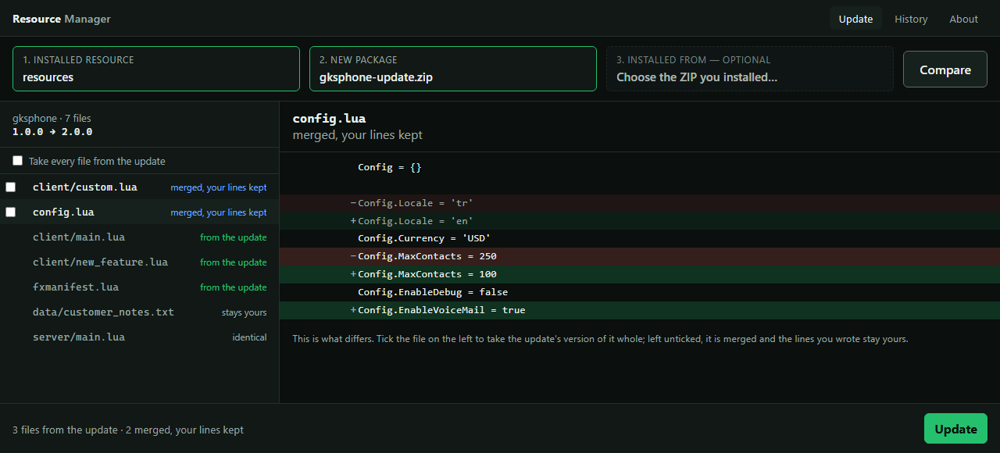
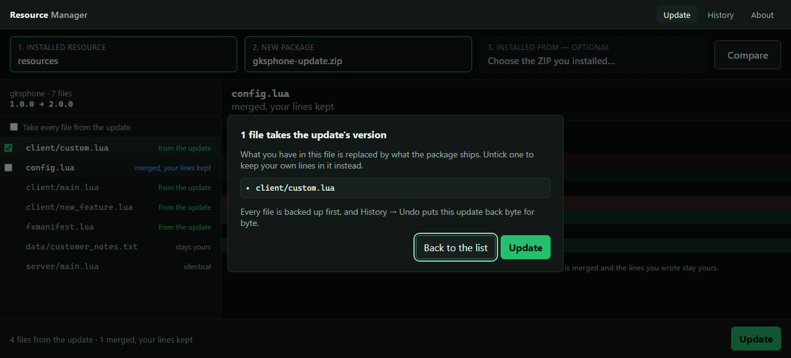
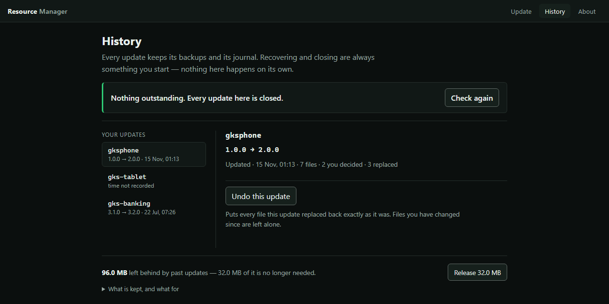

# GKSHOP Resource Manager

**Update a FiveM resource without losing the work you did to it.**



## The problem

FiveM's Asset Escrow encrypts a resource's Lua and model files. When the developer uploads a new
version, it replaces the old one in your account — so the package you originally installed from is
usually gone. Every merge tool that needs that original to work safely is a tool you cannot use.

Meanwhile the files escrow *cannot* encrypt — `config.lua`, your locales, your own additions, the
JSON a phone script keeps its settings in — are exactly the ones a straight overwrite destroys.

So the choice ends up being: skip the update, or re-do your work after every one.

## What this does

It takes the two things you actually have — the installation and the new package — and works out
what the update would change, file by file. You decide what to hand over. It keeps the rest.

* A line you wrote stays yours.
* A line only the developer changed arrives.
* A settings file the developer relaid out is combined key by key rather than being an either-or.
* Files you created that the package does not mention are left alone.
* Files escrow protects — which you could not have edited anyway — are taken from the update.

If you still have the package you installed from, give it as a third source and there are fewer
questions: a file that differs from the update but still matches what you installed was changed by
the developer alone, so nobody needs to ask you about it.

## What it will not do

* It never runs `fxmanifest.lua`. It reads the parts it needs; nothing is executed.
* It never touches anything outside the resource directory you selected.
* No network, no account, no telemetry, no automatic updater. It does not log in to the Cfx
  portal and does not download anything.
* It does not run SQL.
* It does not delete a file just because the package does not contain it.
* It never changes the live installation while working out what an update would do.

## It tells you before it writes, and it can put it back

Everything still ticked is named back to you before a single byte is written. Pressing Back writes
nothing at all.



Every file is backed up first, the apply is one transaction with a durable journal, and an update
can be put back byte for byte — including after a crash, and without the package it came from.
Files you changed *after* the update are left alone when it is reversed.



## Requirements

Windows 10 or 11 with the Microsoft Edge WebView2 runtime, which recent Windows installs already
have. The core carries POSIX paths as well, but Windows is what is built and verified.

## Getting it

No installer is published yet. Build it from a checkout:

```bash
cargo build --release --workspace
```

```bash
npm --prefix apps/gkrm-desktop ci
```

```bash
npm --prefix apps/gkrm-desktop run tauri:build:no-bundle
```

The application is then `target/release/gkrm-desktop.exe`, and the command-line tool is
`target/release/gkrm.exe`.

## Using it

The whole update is one screen.

1. **Choose the installed resource.** Point at the installation root that holds the resource
   directory, or at the resource directory itself. Either works.
2. **Choose the new package** — the `.zip` you downloaded.
3. **Optionally choose the package it was installed from.** Skip it if you no longer have it;
   supplying it just means fewer questions.
4. **Compare.** You get the files the update would change, with the version each side declares.
   Everything arrives ticked.
5. **Untick what you want to keep** — the editable files you have changed.
6. **Update.** Before anything is written, a confirmation names the files about to be handed
   over. Going back from it writes nothing at all.

If the installation already matches the package, the screen says *Already up to date* and offers
no buttons.

Afterwards, the **History** screen holds what the update left behind. A finished update blocks
the next one until you close it explicitly — closing is additive and keeps every backup and
journal. From there you can also put an update back, byte for byte, without needing the package
again; files you changed since are left alone. The same screen names what is being kept on disk
and lets go of only what nothing reaches for.

If the application or the machine stops mid-update, the next run notices and offers an explicit
recovery. There is no automatic repair and no force option: the result is always that the update
was finished, that it was put back, or that it needs your attention and nothing was written.

## The command line

For the read-only surfaces:

```bash
gkrm inspect --installed <installation-root> --package <update.zip> --output text
```

```bash
gkrm plan --installed <installation-root> --package <update.zip> --output text
```

Both report what an update would do and change nothing. `--installed` is the installation root
that *contains* resource directories, not a single resource directory.

## Trying it without a real installation

[`fixtures/`](fixtures/README.md) holds a small synthetic resource and the packages to update it
with. Nothing there is anyone's real data.

```bash
cargo run -p gkrm-cli -- plan --installed ./fixtures/installed --package ./fixtures/packages/gksphone-update.zip --output text
```

## How it is put together

| | |
| --- | --- |
| `crates/gkrm-core` | Every decision about the filesystem: inspection, planning, merging, staging, apply, rollback and recovery. Nothing else is allowed to write to an installation. |
| `apps/gkrm-cli` | The command-line interface. |
| `apps/gkrm-desktop` | A Tauri shell: a Vue frontend and a thin Rust adapter over the core. |

The frontend never receives a real filesystem path and cannot reach the filesystem, a shell, the
network, or a dialog plugin on its own. It talks to exactly twenty-four typed commands and nothing
else.

## Developing

```bash
cargo test --workspace
```

```bash
npm --prefix apps/gkrm-desktop run test:unit
```

```bash
npm --prefix apps/gkrm-desktop run dev:harness
```

The last one opens the real interface in a browser against mocked IPC, which is how the screens
above were captured. It is never part of a build.

Before sending a change: formatting, Clippy with warnings denied, the Rust suites, the frontend
suite, and the generated-output audits. CI runs the same set.

## Contributing

Issues and pull requests are welcome. [`CONTRIBUTING.md`](CONTRIBUTING.md) states the rules the
codebase is held to — in particular that update logic stays in the core, that incoming packages
are untrusted input, that every mutating operation supports rollback, and that nothing silently
resolves an ambiguous merge. A change that cannot keep those is not a change this can take.

## Licence

[MIT](LICENSE). Use it, change it, ship it.

The dependencies keep their own licences — mostly MIT and Apache-2.0, with a handful of MPL-2.0
components including the Lua parser. Source distribution carries no obligation beyond this file;
publishing a built binary does, and the notices for that are generated rather than written by
hand.
